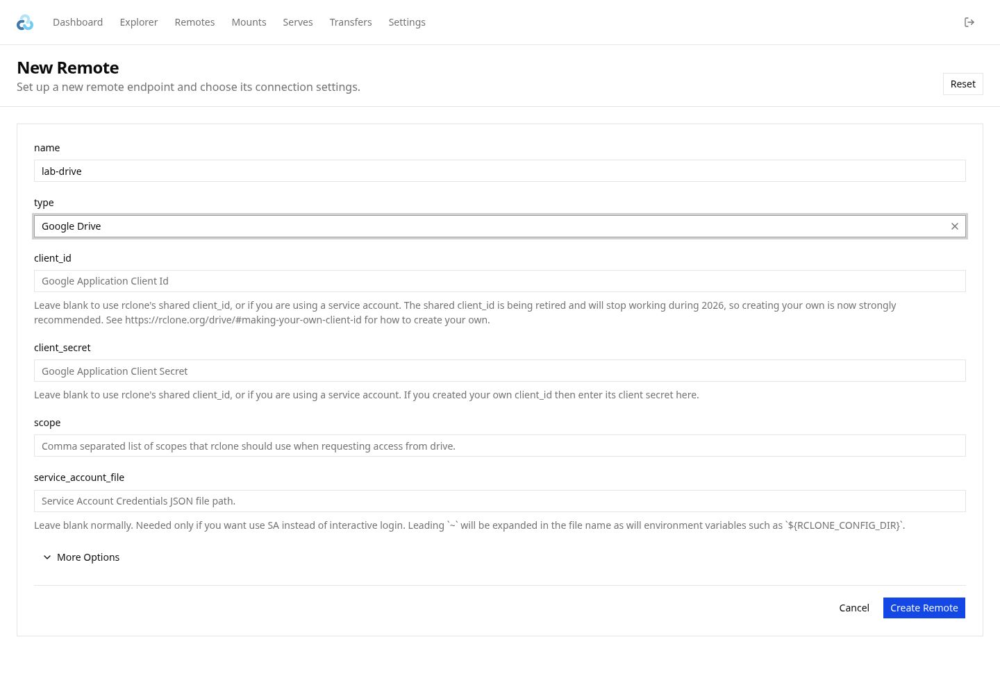

# 多台電腦的資料同步

**讀者：** operator、agent。將 checkout 綁到 Labdata，在多台電腦間傳輸量測資料。

**Last updated:** 2026-11-25

## 資料放在哪裡

每個 Labdata prefix 有一個實體本機資料根和一個雲端資料根。例如 prefix `alice/pc1/sim` 可對應 `~/QubitData/alice/pc1/sim` 與 `lab-drive:QubitData/alice/pc1/sim`。兩端都用 `result/` 和 `Database/` 存放資料。Checkout 的同名目錄連到綁定的本機資料根。推拉都使用實體路徑。

Prefix 識別資料集，不由主機名或使用者名推導。在另一台電腦綁定同一個 prefix 和雲端根，就會使用同一份雲端資料，本機 Labdata 可以放在不同位置。Prefix 可用一段或多段名稱，段與段用 `/` 分隔。不能有空段、`.`、`..`、反斜線，或名為 `result`、`Database` 的段。

工具照原路徑複製舊 Labber 目錄、非 entry 資料夾和 `Database/` 根的零散檔案，不轉換格式。

## 第一次設定

在 repo root 執行，選一個代表資料集的 prefix。

```bash
uv run --directory . --no-sync -- python scripts/sync_data.py setup --prefix pc1/alice
```

1. 首次啟動會下載並驗證固定版 rclone，再開啟官方 Web GUI。`setup --no-browser` 只印網址。網址含本機登入憑證，不要分享。
2. 在 **Remotes → Add New Remote** 選雲端服務並完成授權。已有 rclone remote 可直接重用。Google Drive 的共用 OAuth client 有 2026 年停用警告。若共用 client 無法授權，請用[自有 client](https://rclone.org/drive/#making-your-own-client-id)。只需拉資料的帳號可設定 `drive.readonly`。
3. 在 **Explorer** 進入雲端根，例如 `lab-drive:QubitData`，按 **Refresh**。不要進到來源目錄，也不要進到 `result` 或 `Database`。回終端機核對印出的路徑，按 Enter 確認。
4. 終端機詢問本機 Labdata 根。直接按 Enter 使用 `~/<雲端根資料夾名>`，例如 `~/QubitData`；選了整個 remote 時改用 remote 名稱。Labdata 可放在 checkout 內或外。也可用 `--labdata ../QubitData` 略過提示。相對路徑以命令執行時的工作目錄為準。
5. 核對顯示的 Labdata prefix、本機資料根和雲端資料根，按 Enter 綁定。Windows 在本機 NTFS 上建立 junction，Linux 建立目錄符號連結。兩個連結都驗證成功才保存設定。Ctrl+C 可在確認前取消，rclone 已保存的帳號變更不會還原。



同一配置重跑 `setup` 時，正確的連結會保留。若 `result` 或 `Database` 已有檔案、目錄、失效連結或指往其他地方，setup 會列出衝突位置和預期目標，不搬資料、不建立新連結，也不覆寫設定。新目標不可和兩個連結位置重疊，例如不能把 Labdata 設成 checkout 的 `result/Labdata`。

若建立連結失敗，setup 會列出失敗的連結路徑、預期目標和原始錯誤，不保存 checkout 設定，也不刪除已建立的連結或目錄。Windows 建立 junction 時可能留下實體目錄；若出現檢查提示，先檢查該目錄和其中的資料，再重跑 setup。符號連結已在 Linux 實測；本次未在原生 Windows／NTFS 執行 junction 測試。

每個 checkout 的 `.data-sync/sync.json` 保存位置，不含 token。舊版 checkout 設定不會自動升級，請重跑 `setup --prefix`。若已有資料，先依[下面的步驟](#把-checkout-資料搬到-labdata)自行搬移。`rclone.conf` 沿用使用者層設定，在同一使用者的 checkout 間共用。它含帳號憑證，不要提交或分享。

## 上傳與下載

```bash
uv run --directory . --no-sync -- python scripts/sync_data.py status --json
uv run --directory . --no-sync -- python scripts/sync_data.py sources
uv run --directory . --no-sync -- python scripts/sync_data.py push --dry-run
uv run --directory . --no-sync -- python scripts/sync_data.py push
uv run --directory . --no-sync -- python scripts/sync_data.py pull
uv run --directory . --no-sync -- python scripts/sync_data.py push alice/pc1/sim
uv run --directory . --no-sync -- python scripts/sync_data.py pull alice/pc1/sim bob --dry-run
uv run --directory . --no-sync -- python scripts/sync_data.py pull --all
```

`status --json` 讀本機設定與連結，不測試雲端連線或授權。`bound` 表示兩個連結都到達設定的目標；`configured` 還要求本機有 `rclone.conf`。任一條件不符時回傳 1。未設定的 `push`、`pull`、`sources` 會提示先執行 setup，不開瀏覽器。

`push` 從本機 Labdata 上傳到雲端，`pull` 往反方向下載。省略 prefix 時，兩個命令都用 checkout 綁定的值。指定 prefix 時，兩端都在各自的根接上同一段路徑。操作綁定的 prefix 前，工具會檢查 checkout 的兩個連結。缺少連結或連結指錯位置時會停止，請檢查後重跑 setup。

`sources` 列出雲端直接含 `result/` 或 `Database/` 的 prefix。`pull` 可以列出數個 prefix，也可以用 `--all` 下載清單中的其他 prefix，不動本 checkout 綁定的資料。巢狀 prefix 如 `alice` 和 `alice/pc1/sim` 可以並存，各自只傳自己的兩棵資料樹。

普通推拉使用 rclone `copy --update`，保留目的地較新的同名檔案。`push --force` 或 `pull --force` 會重新複製來源檔案，即使來源較舊，或兩端檔案大小與修改時間相同。只有單一 prefix 可以強制覆寫。`pull --all --force` 和指定多個 prefix 的 `pull --force` 都會報錯。覆寫前可先預覽：

```bash
uv run --directory . --no-sync -- python scripts/sync_data.py pull alice/pc1/sim --force --dry-run
```

兩種模式都批量平行複製檔案，`--jobs` 可設定平行傳輸數量，預設 8。兩種模式都排除 `*.lock`，不刪目的地獨有的檔案，不另外建立空目錄，也不合併 YAML 或 ledger。請勿讓兩台電腦同時寫同一資料集。`--dry-run` 只預覽複製，不傳輸，也不讀寫同步基準。

普通和強制推拉都在複製成功後核對兩端的檔案。只有兩端大小與 MD5 相符的檔案才推進基準；未能證實一致的檔案保留原紀錄。基準保存在 `<labdata>/.data-sync/state/`，依雲端根與 prefix 分開。使用同一 Labdata、雲端根與 prefix 的 checkout 會共用紀錄。工具不會把基準上傳到雲端。普通推拉仍由 rclone 的 `--update` 決定是否複製，不根據基準選擇覆寫方向。

若正式推拉指出基準損壞或版本不支援，工具會在複製前停止並列出紀錄路徑。請先備份該紀錄並查明問題。若複製成功但工具未能完成整批核對，它會提示檔案可能已複製、基準未更新。排除核對失敗的原因後，若兩端情況不變，可重跑普通推拉來核對，不必加 `--force`。工具不會自動清除紀錄或還原已傳輸的檔案。

**量測中上傳可能帶走未寫完的檔案。** 等 Run 結束後再 push 一次。

量測機若還在用舊 checkout，也可以用已設定雲端帳號的 rclone 直接上傳。請先設定下例的 `checkout`、`cloud_root` 與 `prefix`：

```bash
rclone copy --update --exclude '*.lock' "$checkout/Database" "$cloud_root/$prefix/Database"
rclone copy --update --exclude '*.lock' "$checkout/result" "$cloud_root/$prefix/result"
```

## 開啟外來來源

在彙整機以來源目錄當作 `--project-root`。路徑需用已存在的絕對路徑。不要傳 `<labdata>` 或 `Database/` 本身。

```bash
uv run --directory . --no-sync -- python -m apps.measure \
  --project-root "$HOME/QubitData/alice/pc1/sim"
```

`apps.fluxdep`、`apps.dispersive` 也用 `--project-root` 選資料根。MCP 開新 GUI 時填 `project_root`；已開啟的 GUI 不會因 MCP attach 改根。GUI 一次只開一個來源，要看別的來源就換 project root。在外來根執行 Save 會寫入本地副本。不指定 prefix 的 `push` 不會上傳這些存檔。需要回傳時，請明確指定該 prefix。

## 把 checkout 資料搬到 Labdata

1. 備份現有資料，關閉所有使用這兩個目錄的 GUI 與工具。
2. 若 `<labdata>/<prefix>` 沒有同名目錄，將 checkout 內既有的 `result/` 與 `Database/` 搬到該處。若兩端都已有資料，先自行核對並決定如何合併。不要用 setup 取代核對。
3. 重跑 `setup --prefix <prefix>` 並確認 `status` 成功。Setup 會沿用搬好的實體目錄，再建立 checkout 連結。

Measure 的唯讀 Results Browser 不跟隨 checkout 的資料根 symlink。要瀏覽時，用實體 prefix 目錄當作 `--project-root` 開啟。

以實體來源目錄執行升級工具時，預設備份放在來源旁，例如 `../QubitData/pc1/alice-backup/`。它不在 `result/` 或 `Database/` 裡，所以不會被 push。

固定版 rclone、快取與設定服務的維護方式見[同步模組說明](../lib/zcu_tools/utils/data_sync/README.md)。
