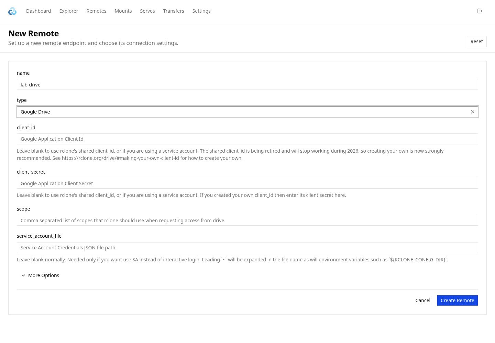
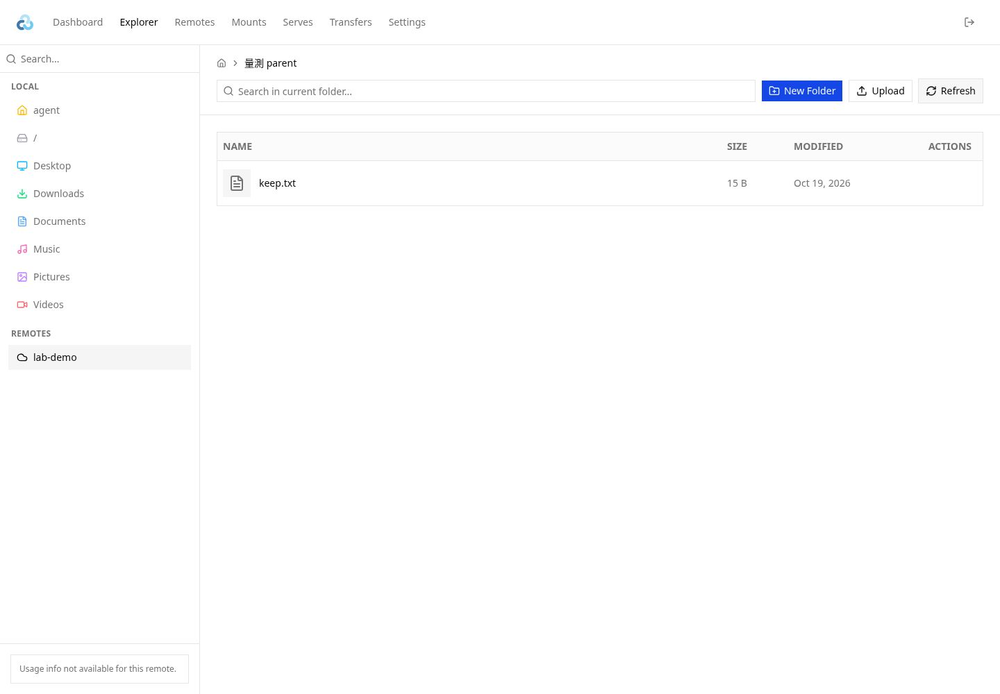

# 結果傳輸：首次 GUI 設定，之後 CLI

**讀者：** operator、agent。設定雲端位置，並從 CLI 上傳或下載結果。
入口使用專案準備的固定版 rclone。

**Last updated:** 2026-10-21

## 第一次在桌面設定

在 repo root 執行：

```bash
uv run --directory . --no-sync -- python scripts/transfer_results.py setup
```

Windows、macOS、Linux 使用相同的 Python 入口與命令，不需要 shell wrapper。
需要先完成專案原有的 Python／uv 環境設定。

1. 首次啟動會下載並核對固定版 rclone，之後在終端機印出一個私人 setup 網址，並嘗試用預設瀏覽器開啟官方 Web GUI。想用其他瀏覽器登入時，把印出的網址貼到該瀏覽器即可；加 `--no-browser` 則只印網址、不自動開啟。網址含本機登入憑證，不要分享。
2. 在 **Remotes → Add New Remote** 選 **Google Drive**，例如取名 `lab-drive`，
   依瀏覽器登入與同意畫面完成授權。已連結的帳號可直接重用。
3. 進入 **Explorer**，點選左側該 remote，逐層進入要用的**雲端父資料夾**，按 **Refresh**。
   若日後想傳輸 `result/Si001`，這裡選擇雲端 `measurement-results/`，
   不要進入它底下的 `Si001/`。
4. 回到終端機，核對顯示的 `Selected cloud parent: lab-drive:measurement-results`。
   確定後按 **Enter** 保存；按 Ctrl+C 可取消。
5. 看見 `Saved cloud parent` 即完成。程式會停止 GUI／API 服務，
   瀏覽器分頁可以關閉，之後 CLI 不需要這些服務。





第二張圖使用假的本機 alias `lab-demo` 示範資料夾選取，不是已連結 Google Drive 的證據。
終端機會顯示它對應的 `lab-demo:量測 parent`；確認的就是目前這個資料夾。
官方 GUI 會快取瀏覽結果，所以每次選好資料夾都要按 Refresh，並核對終端機印出的路徑。
重新整理本地磁碟、尚在載入或列舉失敗時，不會沿用上一個雲端位置來保存。

**Google OAuth 前提：** rclone v1.75.2 警告共用 OAuth client 將於 2026 年停用，
不能承諾 `client_id`／`client_secret` 留空可長期使用。
專用 client 由專案維護者準備，並在官方表單設定；不用在聊天中提供值。
對既有資料夾上下載通常選 `scope=drive`；只下載可用 `drive.readonly`。
`drive.file` 不能瀏覽所有既有檔案；一般個人登入的 `service_account_file` 留空。
參考 [rclone Drive OAuth 設定](https://rclone.org/drive/#making-your-own-client-id)。

Setup 的用途是授權及選位置。它會拒絕官方介面的 Upload、Transfer、Delete 等資料寫入請求，保留雲端資料原樣。
選好資料夾後，回終端機按 Enter 保存位置。Copy here 是傳輸操作，setup 會拒絕該請求。
官方 GUI 的瀏覽位置透過這一步確認後才保存。
設定未完成或取消時，既有的已保存位置會保留；帳號連線的修改則由 rclone 即時保存。

## 日常從 CLI 上傳／下載

新格式本地布局統一為 `result/<name>/`。本指南用 `--local-root` 明確指定 `result/`，
不依賴入口預設值。共同選項放在子命令前。首次設定完成後，指定 entry 名稱：

```bash
# result/Si001 → 已保存的雲端父資料夾/Si001
uv run --directory . --no-sync -- python scripts/transfer_results.py --local-root "$PWD/result" upload Si001

# 雲端父資料夾/Si001 → result/Si001
uv run --directory . --no-sync -- python scripts/transfer_results.py --local-root "$PWD/result" download Si001

# 多個 entry；每次最多 8 個檔案並行
uv run --directory . --no-sync -- python scripts/transfer_results.py --local-root "$PWD/result" upload Si001 Si002 -j 8

# 先預覽，不寫目的地資料
uv run --directory . --no-sync -- python scripts/transfer_results.py --local-root "$PWD/result" upload Si001 --dry-run

# 所有 entry（只列出來源父目錄下的資料夾）
uv run --directory . --no-sync -- python scripts/transfer_results.py --local-root "$PWD/result" upload --all
uv run --directory . --no-sync -- python scripts/transfer_results.py --local-root "$PWD/result" download --all
uv run --directory . --no-sync -- python scripts/transfer_results.py --local-root "$PWD/result" download --all --dry-run
```

GUI 關閉、主機重新開機後仍可使用。OAuth token 由 rclone 在需要時更新；
帳號授權被撤銷時，CLI 會報錯，需要回桌面重新設定／授權，不會自行開瀏覽器。

帳號憑證在同一使用者的不同 checkout 間共用；每個 checkout 各自保存雲端父資料夾。
每次明填本地根目錄。上例在 repo root 執行，以 `$PWD/result` 指向當前 checkout；
要用另一個本地父資料夾，也在子命令前提供 `--local-root`：

```bash
uv run --directory . --no-sync -- python scripts/transfer_results.py --local-root /data/result download Si001
```

## Agent／Bash 使用

從任何工作目錄呼叫同一入口即可，不必啟動桌面或 GUI：

```bash
uv run --directory /workspace/Qubit-measure --no-sync -- python scripts/transfer_results.py --local-root /workspace/Qubit-measure/result status --json
uv run --directory /workspace/Qubit-measure --no-sync -- python scripts/transfer_results.py --local-root /workspace/Qubit-measure/result download Si001 --dry-run
uv run --directory /workspace/Qubit-measure --no-sync -- python scripts/transfer_results.py --local-root /workspace/Qubit-measure/result download Si001
```

`status --json` 只輸出非機密設定，例如：

```json
{"configured": true, "remote_parent": "lab-drive:measurement-results", "local_root": "/workspace/Qubit-measure/result", "config_dir": "/home/user/.config/qubit-measure/result-transfer", "settings_dir": "/workspace/Qubit-measure/.result-transfer"}
```

它檢查設定檔存在與格式，不代表網路或 Google token 仍然可用。
未設定時 `status` 返回 1。缺少設定的非互動 upload/download 返回 2，
不開 GUI、不等待輸入，會提示先在桌面執行 setup。
互動終端機第一次執行 upload/download 時，會先進 setup，完成後繼續該次命令。

Entry 只能是一層資料夾名稱，支援中文與空白（Bash 中要加引號）；
拒絕路徑、`..`、選項形狀的名稱與 entry 根 symlink。
Upload 會先檢查整批本地來源都存在，再開始任何傳輸。
任何 entry 傳輸失敗即停止後續 entry，並返回 rclone 原始錯誤碼；
例如遠端來源不存在返回 3。取消返回 130，成功返回 0。
Rclone 的傳輸輸出直接送到終端機，可由 Bash 正常重導向。

`--all` 與明確 entry 名稱二擇一。Upload 列出本地父目錄的第一層資料夾，
略過 symlink 與 `*.lock` 資料夾；download 列出已保存雲端父目錄的第一層資料夾。
兩者都不傳輸父目錄下的獨立檔案，entry 內的子目錄則照常遞迴傳輸。
發現的名稱會排序、整批驗證後才開始複製。空來源成功返回 0，
不存在或無法列舉的來源會報錯，不當成空目錄成功。

## 比較與刪除規則

上下傳皆使用 rclone **copy**，一次命令處理所有指定 entry（以 `--filter` 選取，`*.lock` 排除），帶 `--update --fast-list --checkers 16`，並放寬 Google Drive 的請求間隔（`--drive-pacer-min-sleep 10ms --drive-pacer-burst 200`，遇速率限制 rclone 會自動退避重試）；`-j` 預設 8 個平行傳輸。每個複製、更新或略過的檔案都會逐行印出（`-v`）；在終端機執行時另有 rclone 即時進度畫面（`--progress`，含列舉中、傳輸中的檔案與速率），非終端機（例如 agent）則每 10 秒印一行摘要：

- 複製新檔，更新來源較新的檔案，寫入檔案時建立所需目錄。空資料夾會略過。
- 保留目的地較新的同名檔案、目的地獨有的檔案，以及全部來源檔案。
- 排除 `*.lock` 檔案與資料夾。

CLI 僅提供 copy，來源與目的地各自保留檔案，雙向傳輸時也逐方向比較。
相同時間的差異依 rclone 的大小及 backend checksum 規則判斷。
中斷後可重跑命令重新比較，單一檔案的續傳能力依 backend 而定。
同一批檔案一次只交給一個進程傳輸。比較檔案時間只決定複製或略過，並行寫入仍可能互相覆蓋。

## 重新設定與憑證保存

換帳號或改雲端父資料夾時，再執行 `setup`。
兩個設定檔分開保存：`rclone.conf` 含帳號與 token，放在下表的使用者設定目錄，同一使用者的所有 checkout 共用，登入一次即可；`transfer.json` 只保存選定的 remote 路徑，放在各 checkout 的 `.result-transfer/`（已 gitignore），所以不同 checkout 各自選雲端父資料夾、不會上傳到同一處。每個 checkout 第一次使用時執行一次 `setup` 選資料夾。
不讀舊 `.env`、`token.json` 或 `GOOGLE_DRIVE_PARENT_FOLDER_ID`，也不自動刪除舊憑證檔。
舊入口已移除，沒有相容 wrapper。

| 系統 | 帳號設定目錄（`rclone.conf`） | 快取目錄 |
| --- | --- | --- |
| Windows | `%APPDATA%/qubit-measure/result-transfer` | `%LOCALAPPDATA%/Cache/qubit-measure/result-transfer` |
| macOS | `~/Library/Application Support/qubit-measure/result-transfer` | `~/Library/Caches/qubit-measure/result-transfer` |
| Linux | `$XDG_CONFIG_HOME/qubit-measure/result-transfer`，預設 `~/.config/...` | `$XDG_CACHE_HOME/qubit-measure/result-transfer`，預設 `~/.cache/...` |

`rclone.conf` 不是加密的憑證保管庫，不要提交或分享。
Google 帳號的第三方應用程式管理可撤銷授權；只移除本地 remote 不等於撤銷 Google 授權。
如需隔離帳號或工作流程，可在子命令前提供 `--config-dir`、`--settings-dir` 與 `--cache-dir` 的絕對路徑。

工具版本、校驗方式、setup bridge 與升版驗證見
[結果傳輸模組維護說明](../lib/zcu_tools/utils/result_transfer/README.md#工具準備與維護)。
